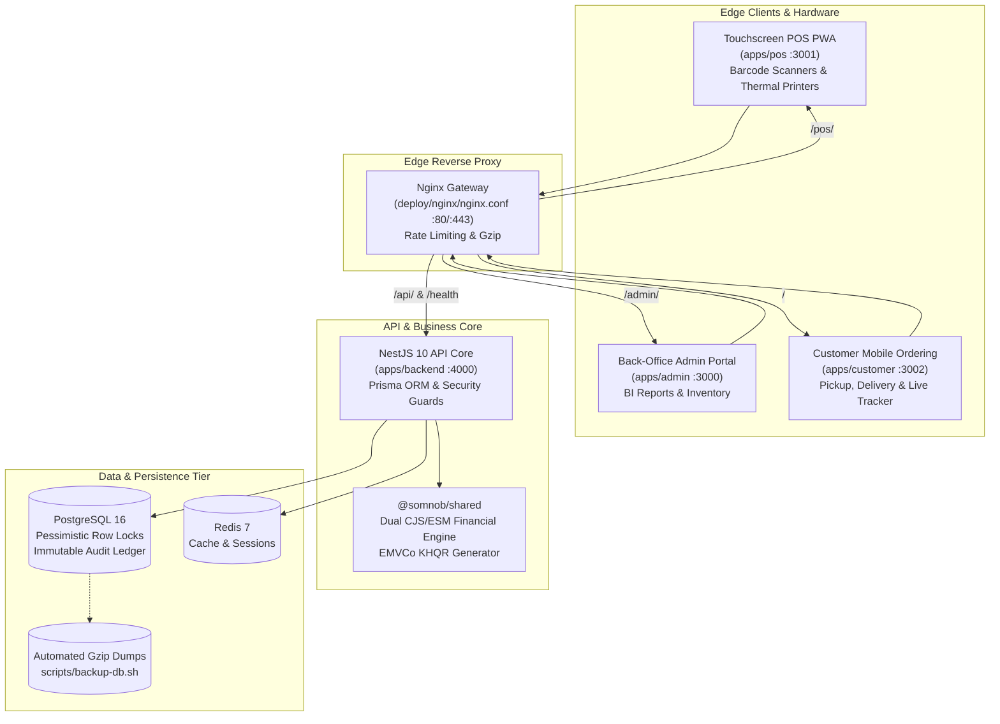

# Somnob POS Ecosystem

> **Enterprise-grade, multi-branch retail and grocery Point of Sale (POS) ecosystem built for high-throughput in-store terminals, dual-currency operations (USD / KHR), dynamic NBC Bakong KHQR payments, and offline-first resilience.**

---

## Architecture Overview



---

## Monorepo Workspaces

Built as a high-performance monorepo managed with **Turborepo v2** and **npm workspaces**:

```
somnob-pos/
├── apps/
│   ├── backend/        # NestJS 10, Prisma ORM, PostgreSQL 16, REST/Swagger API
│   ├── pos/            # Touchscreen PWA (React 18, Vite, Tailwind, IndexedDB)
│   ├── admin/          # Back-Office Portal (Next.js 14 Standalone, BI Analytics)
│   └── customer/       # Mobile Web Ordering (Next.js 14 Standalone, Real-time Stepper)
├── packages/
│   └── shared/         # Dual CJS/ESM shared library (Half-Up rounding, EMVCo KHQR, DTOs)
├── deploy/
│   └── nginx/          # Production reverse proxy gateway configuration
├── docs/               # System architecture, database design & production runbooks
├── scripts/            # Automated PostgreSQL backup and disaster recovery scripts
├── docker-compose.yml  # Local developer infrastructure (Postgres 16 + Redis 7)
├── docker-compose.prod.yml # Production multi-container composition
└── turbo.json          # Turborepo task pipeline configuration
```

---

## Key Features

### 1. Dual-Currency Financial Engine (USD & KHR)
* **Authoritative Accounting:** Stored with exact decimal precision in USD base (`Decimal(12, 2)`).
* **Operational Precision:** Daily branch exchange rates (standard $1.00 = 4,100៛) converted with **Half-Up Rounding** without floating-point IEEE 754 drift.
* **Mixed-Tender Cash Calculator:** Allows cashiers to accept mixed tenders (e.g. part $20 bill, part 50,000៛ note) with live change calculated in both currencies.

### 2. EMVCo Dynamic NBC Bakong KHQR
* Native, zero-dependency EMVCo Tag-Length-Value (TLV) payload string generator.
* Compliant with National Bank of Cambodia (NBC) Bakong specifications.
* Dynamic transaction QR codes generated for USD (`840`) and KHR (`116`) with automated CRC16/CCITT-FALSE checksum verification.

### 3. Concurrency & Negative Inventory Defense
* **Row-Level Locking:** Pessimistic lock isolation on checkout transactions prevents overselling when multiple terminals compete for the same stock.
* **Immutable Movement Ledger:** Every stock event (*Sale*, *Refund*, *Stock In*, *Damaged Goods*) is written to an append-only `stock_movements` ledger with quantity-before, quantity-after, and user attribution.

### 4. Cash Register Shifts & Z-Report Reconciliation
* Opening float recorded in both USD and KHR with station lock.
* Automated shift reconciliation calculates expected cash in drawer, actual counted cash, and exact over/short variances.

### 5. Multi-Branch Isolation & Staff RBAC
* Role hierarchy: `SUPER_ADMIN`, `BRANCH_MANAGER`, `CASHIER`, `STOCK_CLERK`.
* Multi-branch isolation guards (`StoreAccessGuard`) guarantee employees cannot access or perform operations on unauthorized branches.

### 6. Offline-First PWA Resilience
* Touchscreen terminal caches product catalog, customers, and active shift state using client-side **IndexedDB**.
* Cash sales queue locally during network disconnects and auto-sync to the server upon reconnection with UUID **idempotency keys** preventing duplicate charging.

---

## Local Development Quickstart

### Prerequisites
* **Node.js:** v18.0.0 or higher (v20+ recommended)
* **npm:** v9.0.0 or higher
* **PostgreSQL:** v16 (or use Docker)

### 1. Clone & Install Dependencies
```bash
git clone https://github.com/uypanha/somnob-pos.git
cd somnob-pos
npm install
```

### 2. Setup Environment Variables
```bash
cp .env.example .env
cp apps/backend/.env.example apps/backend/.env
```

### 3. Initialize Database
```bash
# Generate Prisma Client
npm run db:generate

# Apply Schema Migrations
npm run db:migrate

# Seed Demo Multi-Branch Catalog & Admin Accounts
npm run db:seed
```

### 4. Launch Applications
Run all services concurrently using Turborepo:
```bash
npm run dev
```

| Service | URL | Default Credentials |
| :--- | :--- | :--- |
| **Touchscreen POS Terminal** | [http://localhost:3001](http://localhost:3001) | Cashier PIN: `1234` |
| **Store Management Admin** | [http://localhost:3000](http://localhost:3000) | `admin@somnob.com` / `admin1234` |
| **Customer Mobile Web** | [http://localhost:3002](http://localhost:3002) | Walk-in or Wholesale Member |
| **NestJS Backend API** | [http://localhost:4000/api/v1](http://localhost:4000/api/v1) | JWT Bearer Authentication |
| **Swagger Documentation** | [http://localhost:4000/docs](http://localhost:4000/docs) | Interactive OpenAPI Spec |

---

## Automated Test Suites (94 Passing)

Execute automated unit, financial edge case, and concurrency race-condition tests:

```bash
# Run shared currency & KHQR tests (Node test runner)
npm --workspace=@somnob/shared run test

# Run backend test suites (Jest)
npm --workspace=@somnob/backend run test

# Build all monorepo packages
npm run build
```

---

## Production Deployment with Docker

The ecosystem provides multi-stage, hardened Dockerfiles for every service:

```bash
# 1. Build and start production cluster in background
docker compose -f docker-compose.prod.yml up -d --build

# 2. Run database migrations
docker compose -f docker-compose.prod.yml exec backend npm run db:deploy

# 3. Seed initial store data (first time only)
docker compose -f docker-compose.prod.yml exec backend npm run db:seed
```

### Automated Database Backups:
```bash
# Create compressed backup with 7-day retention pruning
./scripts/backup-db.sh

# Restore from backup
./scripts/restore-db.sh ./backups/somnob_pos_prod_YYYYMMDD_HHMMSS.sql.gz
```

For complete zero-downtime rolling update instructions, see the [Production Deployment Guide](docs/production-deployment.md).

---

## Documentation

* [Requirements & Architecture Specification](docs/requirements-and-architecture.md)
* [Database Design & Relational Schema](docs/database-design.md)
* [Production Deployment & Operations Runbook](docs/production-deployment.md)
* [Phase-by-Phase Delivery Roadmap](plans.md)

---

## License

This project is licensed under the [MIT License](LICENSE).
