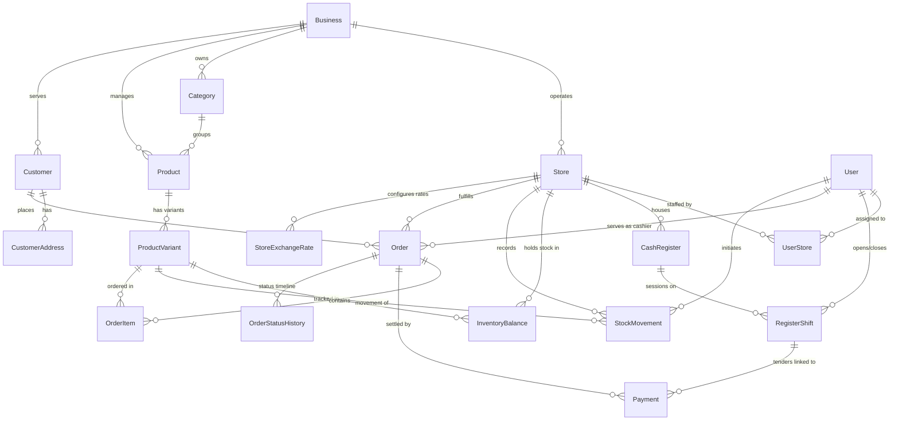

# Somnob POS - Database Design Specification

## Document Information
* **Project Name:** Somnob POS Ecosystem
* **Phase:** 2 - Database Design
* **Status:** Complete / Awaiting User Approval
* **Version:** 1.0.0
* **Date:** 2026-10-18

---

## 1. Objectives & Architectural Principles

The database design provides the foundational data integrity for Somnob POS. It adheres to:
1. **Multi-Branch Isolation with Central Catalog:** A single business entity owns a shared master catalog, while inventory balances, registers, and transactions are strictly scoped to physical branches (`Store`).
2. **Financial Precision & Dual-Currency:**
   * Base monetary amounts (USD) use PostgreSQL `DECIMAL(12, 2)` to eliminate floating-point precision loss.
   * Operational currency (KHR) uses integer-level precision (`DECIMAL(14, 0)` or `INT`) alongside explicit exchange rates recorded with every financial transaction.
3. **Traceable Inventory (Audit Ledger Pattern):**
   * Inventory balances (`InventoryBalance`) store the live count per variant per branch.
   * Every alteration to inventory **MUST** produce an immutable `StockMovement` ledger entry with a movement type, user reference, and reason.
4. **Concurrency Safety & Idempotency:**
   * Checkouts utilize pessimistic row-level locking (`SELECT ... FOR UPDATE`) on `InventoryBalance` to prevent overselling.
   * Payment transactions enforce a `UNIQUE` idempotency key to prevent double charging on retried requests or offline sync.
5. **Auditing & Soft Deletion:**
   * Critical operational records (Orders, Payments, Shifts, Movements) are never hard-deleted. Catalog items support soft-deletion (`isActive` / `deletedAt`).

---

## 2. Entity Relationship Diagram (ERD)



---

## 3. Database Tables & Specifications

### 3.1 Organization & Multi-Branch Domain

#### `businesses`
Central legal entity.
| Column | Type | Constraints | Description |
| :--- | :--- | :--- | :--- |
| `id` | UUID | PK, default `gen_random_uuid()` | Unique business ID |
| `name` | VARCHAR(150) | NOT NULL | Business trading name |
| `base_currency` | VARCHAR(3) | NOT NULL, DEFAULT `'USD'` | Primary financial accounting currency |
| `created_at` | TIMESTAMPTZ | NOT NULL, DEFAULT `NOW()` | Record creation timestamp |
| `updated_at` | TIMESTAMPTZ | NOT NULL | Record update timestamp |

#### `stores`
Individual physical branch or retail location.
| Column | Type | Constraints | Description |
| :--- | :--- | :--- | :--- |
| `id` | UUID | PK, default `gen_random_uuid()` | Unique branch store ID |
| `business_id` | UUID | FK -> `businesses(id)`, NOT NULL | Parent business |
| `name` | VARCHAR(100) | NOT NULL | Branch name (e.g. "BKK1 Branch") |
| `code` | VARCHAR(20) | NOT NULL, UNIQUE(business_id, code) | Branch code (e.g. "STR-001") |
| `phone` | VARCHAR(30) | NULL | Store phone contact |
| `address` | TEXT | NULL | Physical address |
| `is_active` | BOOLEAN | NOT NULL, DEFAULT `TRUE` | Branch operational status |
| `created_at` | TIMESTAMPTZ | NOT NULL, DEFAULT `NOW()` | Timestamp |
| `updated_at` | TIMESTAMPTZ | NOT NULL | Timestamp |

#### `store_exchange_rates`
Historical and active currency exchange rate for dual-currency operations.
| Column | Type | Constraints | Description |
| :--- | :--- | :--- | :--- |
| `id` | UUID | PK | Unique ID |
| `store_id` | UUID | FK -> `stores(id)`, NOT NULL | Branch location |
| `from_currency` | VARCHAR(3) | NOT NULL, DEFAULT `'USD'` | Source currency |
| `to_currency` | VARCHAR(3) | NOT NULL, DEFAULT `'KHR'` | Target currency |
| `rate` | DECIMAL(10, 4) | NOT NULL | Exchange multiplier (e.g., 4100.0000) |
| `is_active` | BOOLEAN | NOT NULL, DEFAULT `TRUE` | Whether currently active for checkout |
| `created_at` | TIMESTAMPTZ | NOT NULL, DEFAULT `NOW()` | Effective starting timestamp |

---

### 3.2 User Management & Access Control

#### `users`
Employees and administrators.
| Column | Type | Constraints | Description |
| :--- | :--- | :--- | :--- |
| `id` | UUID | PK | User identifier |
| `business_id` | UUID | FK -> `businesses(id)`, NOT NULL | Organization |
| `email` | VARCHAR(255) | UNIQUE, NOT NULL | Login email |
| `password_hash` | VARCHAR(255) | NOT NULL | Argon2 / Bcrypt hash |
| `full_name` | VARCHAR(100) | NOT NULL | Full name of employee |
| `role` | VARCHAR(30) | NOT NULL | Enum: `SUPER_ADMIN`, `BRANCH_MANAGER`, `CASHIER`, `STOCK_CLERK` |
| `pin_code_hash` | VARCHAR(255) | NULL | Quick 4-6 digit POS switch PIN hash |
| `is_active` | BOOLEAN | NOT NULL, DEFAULT `TRUE` | Account status |
| `created_at` | TIMESTAMPTZ | NOT NULL, DEFAULT `NOW()` | Timestamp |
| `updated_at` | TIMESTAMPTZ | NOT NULL | Timestamp |

#### `user_stores`
Many-to-many relationship mapping users to their authorized branch locations.
| Column | Type | Constraints | Description |
| :--- | :--- | :--- | :--- |
| `id` | UUID | PK | Junction ID |
| `user_id` | UUID | FK -> `users(id)`, NOT NULL | User reference |
| `store_id` | UUID | FK -> `stores(id)`, NOT NULL | Authorized branch reference |
| `is_default` | BOOLEAN | NOT NULL, DEFAULT `FALSE` | Primary assigned store |
| Unique constraint on `(user_id, store_id)` |

---

### 3.3 Product Catalog & Variants

#### `categories`
Hierarchical product categorization.
| Column | Type | Constraints | Description |
| :--- | :--- | :--- | :--- |
| `id` | UUID | PK | Category ID |
| `business_id` | UUID | FK -> `businesses(id)`, NOT NULL | Business |
| `name` | VARCHAR(100) | NOT NULL | Category name |
| `slug` | VARCHAR(120) | NOT NULL, UNIQUE(business_id, slug) | URL/UI slug |
| `parent_id` | UUID | FK -> `categories(id)`, NULL | Parent category for subcategories |
| `sort_order` | INT | NOT NULL, DEFAULT `0` | Touchscreen UI display order |
| `is_active` | BOOLEAN | NOT NULL, DEFAULT `TRUE` | Visibility |

#### `products`
Master product definitions.
| Column | Type | Constraints | Description |
| :--- | :--- | :--- | :--- |
| `id` | UUID | PK | Product ID |
| `business_id` | UUID | FK -> `businesses(id)`, NOT NULL | Business owner |
| `category_id` | UUID | FK -> `categories(id)`, NULL | Primary category |
| `name` | VARCHAR(200) | NOT NULL | Product title |
| `description` | TEXT | NULL | Description / ingredients |
| `image_url` | TEXT | NULL | Master thumbnail |
| `has_variants` | BOOLEAN | NOT NULL, DEFAULT `FALSE` | Indicates if product has size/color options |
| `is_active` | BOOLEAN | NOT NULL, DEFAULT `TRUE` | Catalog visibility |
| `deleted_at` | TIMESTAMPTZ | NULL | Soft-deletion flag |
| `created_at` | TIMESTAMPTZ | NOT NULL, DEFAULT `NOW()` | Timestamp |
| `updated_at` | TIMESTAMPTZ | NOT NULL | Timestamp |

#### `product_variants`
The sellable, barcode-bearing inventory item.
| Column | Type | Constraints | Description |
| :--- | :--- | :--- | :--- |
| `id` | UUID | PK | Variant ID |
| `product_id` | UUID | FK -> `products(id)`, NOT NULL | Parent product |
| `variant_name` | VARCHAR(100) | NOT NULL | e.g. "Standard", "Large 500ml", "Red / XL" |
| `sku` | VARCHAR(64) | NOT NULL, UNIQUE(product_id, sku) | Stock Keeping Unit |
| `barcode` | VARCHAR(64) | NULL, UNIQUE | EAN-13, UPC, Code-128 |
| `cost_price_usd` | DECIMAL(12, 2) | NOT NULL, DEFAULT `0.00` | Supplier cost in USD |
| `selling_price_usd` | DECIMAL(12, 2) | NOT NULL | Standard retail price in USD |
| `wholesale_price_usd` | DECIMAL(12, 2) | NULL | Approved wholesale price in USD |
| `min_wholesale_qty`| INT | NOT NULL, DEFAULT `1` | Minimum quantity required for wholesale pricing |
| `unit_of_measure`| VARCHAR(20) | NOT NULL, DEFAULT `'PCS'` | e.g., PCS, BOX, KG, PACK |
| `is_active` | BOOLEAN | NOT NULL, DEFAULT `TRUE` | Sellable status |
| `deleted_at` | TIMESTAMPTZ | NULL | Soft-deletion timestamp |

---

### 3.4 Inventory Tracking & Movements (Ledger Pattern)

#### `inventory_balances`
Real-time physical and reserved stock per variant per store.
| Column | Type | Constraints | Description |
| :--- | :--- | :--- | :--- |
| `id` | UUID | PK | Balance ID |
| `store_id` | UUID | FK -> `stores(id)`, NOT NULL | Branch location |
| `variant_id` | UUID | FK -> `product_variants(id)`, NOT NULL | Product variant |
| `quantity_on_hand`| INT | NOT NULL, DEFAULT `0` | Physical stock count |
| `quantity_reserved`| INT | NOT NULL, DEFAULT `0` | Stock held for pending customer orders |
| `reorder_point` | INT | NOT NULL, DEFAULT `5` | Low stock threshold triggering alerts |
| `created_at` | TIMESTAMPTZ | NOT NULL, DEFAULT `NOW()` | Created timestamp |
| `updated_at` | TIMESTAMPTZ | NOT NULL | Last modified timestamp |
| Unique constraint on `(store_id, variant_id)` |

#### `stock_movements`
Immutable audit ledger of every inventory change.
| Column | Type | Constraints | Description |
| :--- | :--- | :--- | :--- |
| `id` | UUID | PK | Movement log ID |
| `store_id` | UUID | FK -> `stores(id)`, NOT NULL | Branch location |
| `variant_id` | UUID | FK -> `product_variants(id)`, NOT NULL | Product variant |
| `movement_type` | VARCHAR(30) | NOT NULL | Enum: `SALE`, `REFUND`, `ADJUSTMENT_IN`, `ADJUSTMENT_OUT`, `TRANSFER_IN`, `TRANSFER_OUT`, `PO_RECEIPT` |
| `quantity_delta` | INT | NOT NULL | Positive (+) or negative (-) change |
| `quantity_before`| INT | NOT NULL | Stock level before movement |
| `quantity_after` | INT | NOT NULL | Stock level after movement |
| `reference_type` | VARCHAR(30) | NULL | E.g. `'ORDER'`, `'ADJUSTMENT'`, `'REGISTER_SESSION'` |
| `reference_id` | UUID | NULL | Associated Order ID or Adjustment ID |
| `reason` | TEXT | NULL | Reason for adjustment (e.g. "Damaged", "Spoilage") |
| `created_by_user_id`| UUID | FK -> `users(id)`, NULL | User who initiated the action |
| `created_at` | TIMESTAMPTZ | NOT NULL, DEFAULT `NOW()` | Timestamp |

---

### 3.5 Cash Register & Shift Reconciliation

#### `cash_registers`
Physical POS terminal hardware / station at a branch.
| Column | Type | Constraints | Description |
| :--- | :--- | :--- | :--- |
| `id` | UUID | PK | Register ID |
| `store_id` | UUID | FK -> `stores(id)`, NOT NULL | Branch location |
| `name` | VARCHAR(50) | NOT NULL | e.g. "Register 1 - Front Counter" |
| `code` | VARCHAR(20) | NOT NULL, UNIQUE(store_id, code) | Machine identifier |
| `is_active` | BOOLEAN | NOT NULL, DEFAULT `TRUE` | Terminal active flag |

#### `register_shifts`
Cashier work shifts with float management and Z-Report closing reconciliation.
| Column | Type | Constraints | Description |
| :--- | :--- | :--- | :--- |
| `id` | UUID | PK | Shift ID |
| `register_id` | UUID | FK -> `cash_registers(id)`, NOT NULL | Register station |
| `user_id` | UUID | FK -> `users(id)`, NOT NULL | Cashier |
| `opened_at` | TIMESTAMPTZ | NOT NULL, DEFAULT `NOW()` | Shift opening time |
| `closed_at` | TIMESTAMPTZ | NULL | Shift closing time |
| `opening_float_usd`| DECIMAL(12, 2) | NOT NULL, DEFAULT `0.00` | Starting USD cash in drawer |
| `opening_float_khr`| DECIMAL(14, 0) | NOT NULL, DEFAULT `0` | Starting KHR cash in drawer |
| `closing_cash_usd` | DECIMAL(12, 2) | NULL | Cashier counted USD at close |
| `closing_cash_khr` | DECIMAL(14, 0) | NULL | Cashier counted KHR at close |
| `expected_cash_usd`| DECIMAL(12, 2) | NULL | System calculated expected USD |
| `expected_cash_khr`| DECIMAL(14, 0) | NULL | System calculated expected KHR |
| `difference_usd` | DECIMAL(12, 2) | NULL | Over / short amount USD |
| `difference_khr` | DECIMAL(14, 0) | NULL | Over / short amount KHR |
| `notes` | TEXT | NULL | Reconciliation comments |
| `status` | VARCHAR(20) | NOT NULL, DEFAULT `'OPEN'` | Enum: `OPEN`, `CLOSED` |

---

### 3.6 Customers & Addresses

#### `customers`
Registered retail/e-commerce customers or loyalty members with wholesale approval workflow.
| Column | Type | Constraints | Description |
| :--- | :--- | :--- | :--- |
| `id` | UUID | PK | Customer ID |
| `business_id` | UUID | FK -> `businesses(id)`, NOT NULL | Business entity |
| `full_name` | VARCHAR(120) | NOT NULL | Customer name |
| `phone` | VARCHAR(30) | NOT NULL, UNIQUE(business_id, phone)| Mobile number |
| `email` | VARCHAR(255) | NULL | Email |
| `password_hash` | VARCHAR(255) | NULL | Optional authentication password |
| `customer_type` | VARCHAR(20) | NOT NULL, DEFAULT `'RETAIL'` | Enum: `RETAIL`, `WHOLESALE` |
| `wholesale_status`| VARCHAR(25) | NOT NULL, DEFAULT `'NONE'` | Enum: `NONE`, `PENDING_APPROVAL`, `APPROVED`, `REJECTED` |
| `wholesale_approved_at`| TIMESTAMPTZ | NULL | Timestamp when approved by owner |
| `wholesale_approved_by_id`| UUID | FK -> `users(id)`, NULL | Owner/Admin user who approved wholesale status |
| `created_at` | TIMESTAMPTZ | NOT NULL, DEFAULT `NOW()` | Timestamp |

#### `customer_addresses`
Delivery addresses for customer orders.
| Column | Type | Constraints | Description |
| :--- | :--- | :--- | :--- |
| `id` | UUID | PK | Address ID |
| `customer_id` | UUID | FK -> `customers(id)`, NOT NULL | Customer reference |
| `label` | VARCHAR(50) | NOT NULL | e.g., "Home", "Office" |
| `recipient_name` | VARCHAR(100) | NOT NULL | Contact name |
| `recipient_phone`| VARCHAR(30) | NOT NULL | Contact phone |
| `street_address` | TEXT | NOT NULL | Street, building, house number |
| `city` | VARCHAR(100) | NOT NULL | City / Province |
| `notes` | TEXT | NULL | Delivery instructions |
| `is_default` | BOOLEAN | NOT NULL, DEFAULT `FALSE` | Default delivery address |

---

### 3.7 Orders, Sales & Order Items

#### `orders`
Authoritative transaction record for both in-store sales and online orders.
| Column | Type | Constraints | Description |
| :--- | :--- | :--- | :--- |
| `id` | UUID | PK | Order internal UUID |
| `order_number` | VARCHAR(32) | NOT NULL, UNIQUE | Human readable code (e.g. "ORD-20261018-0001") |
| `store_id` | UUID | FK -> `stores(id)`, NOT NULL | Fulfillment branch |
| `cashier_user_id`| UUID | FK -> `users(id)`, NULL | In-store cashier |
| `customer_id` | UUID | FK -> `customers(id)`, NULL | Customer (walk-in if NULL) |
| `order_type` | VARCHAR(20) | NOT NULL | Enum: `IN_STORE`, `PICKUP`, `DELIVERY` |
| `pricing_tier` | VARCHAR(20) | NOT NULL, DEFAULT `'RETAIL'` | Enum: `RETAIL`, `WHOLESALE` |
| `subtotal_usd` | DECIMAL(12, 2) | NOT NULL | Net sum of line items |
| `discount_usd` | DECIMAL(12, 2) | NOT NULL, DEFAULT `0.00` | Order-level discount |
| `tax_usd` | DECIMAL(12, 2) | NOT NULL, DEFAULT `0.00` | Tax amount (e.g. VAT) |
| `total_usd` | DECIMAL(12, 2) | NOT NULL | Authoritative final total in USD |
| `exchange_rate` | DECIMAL(10, 4) | NOT NULL | Exchange rate at time of order (USD -> KHR) |
| `total_khr` | DECIMAL(14, 0) | NOT NULL | Converted total in KHR |
| `status` | VARCHAR(25) | NOT NULL | Enum: `DRAFT`, `PENDING`, `PREPARING`, `READY_FOR_PICKUP`, `OUT_FOR_DELIVERY`, `COMPLETED`, `CANCELLED` |
| `is_offline_sale`| BOOLEAN | NOT NULL, DEFAULT `FALSE` | Flag for sales completed during offline POS mode |
| `offline_synced_at`| TIMESTAMPTZ | NULL | Timestamp when offline sale synced to server |
| `notes` | TEXT | NULL | Notes / special requests |
| `created_at` | TIMESTAMPTZ | NOT NULL, DEFAULT `NOW()` | Order creation time |
| `updated_at` | TIMESTAMPTZ | NOT NULL | Update time |

#### `order_items`
Individual line items in an order.
| Column | Type | Constraints | Description |
| :--- | :--- | :--- | :--- |
| `id` | UUID | PK | Item ID |
| `order_id` | UUID | FK -> `orders(id)`, NOT NULL | Parent order |
| `variant_id` | UUID | FK -> `product_variants(id)`, NOT NULL | Variant purchased |
| `product_name` | VARCHAR(200) | NOT NULL | Snapshot of product title |
| `variant_name` | VARCHAR(100) | NOT NULL | Snapshot of variant description |
| `sku` | VARCHAR(64) | NOT NULL | Snapshot of SKU |
| `price_type` | VARCHAR(20) | NOT NULL, DEFAULT `'RETAIL'` | Enum: `RETAIL`, `WHOLESALE` |
| `unit_price_usd` | DECIMAL(12, 2) | NOT NULL | Authoritative unit selling price (retail or wholesale) |
| `cost_price_usd` | DECIMAL(12, 2) | NOT NULL | Unit cost at time of sale (for margin reports) |
| `quantity` | INT | NOT NULL, CHECK(`quantity > 0`) | Number of units purchased |
| `discount_usd` | DECIMAL(12, 2) | NOT NULL, DEFAULT `0.00` | Line item discount |
| `tax_usd` | DECIMAL(12, 2) | NOT NULL, DEFAULT `0.00` | Line item tax portion |
| `subtotal_usd` | DECIMAL(12, 2) | NOT NULL | `(unit_price * quantity) - discount` |

---

### 3.8 Payments & Multi-Currency Settlement

#### `payments`
Immutable payment transactions. Supports split payments (e.g., $10 Cash + 20,500៛ KHQR).
| Column | Type | Constraints | Description |
| :--- | :--- | :--- | :--- |
| `id` | UUID | PK | Payment ID |
| `order_id` | UUID | FK -> `orders(id)`, NOT NULL | Associated Order |
| `shift_id` | UUID | FK -> `register_shifts(id)`, NULL | Associated POS Cashier Shift (if in-store) |
| `payment_method` | VARCHAR(20) | NOT NULL | Enum: `CASH`, `CARD`, `KHQR` |
| `amount_usd` | DECIMAL(12, 2) | NOT NULL | Payment amount applied in USD base |
| `tendered_usd` | DECIMAL(12, 2) | NOT NULL, DEFAULT `0.00` | Physical cash tendered in USD |
| `tendered_khr` | DECIMAL(14, 0) | NOT NULL, DEFAULT `0` | Physical cash tendered in KHR |
| `change_usd` | DECIMAL(12, 2) | NOT NULL, DEFAULT `0.00` | Change returned to customer in USD |
| `change_khr` | DECIMAL(14, 0) | NOT NULL, DEFAULT `0` | Change returned to customer in KHR |
| `exchange_rate` | DECIMAL(10, 4) | NOT NULL | Exchange rate snapshot applied to payment |
| `transaction_ref`| VARCHAR(100) | NULL | Bank terminal code or KHQR MD5/hash |
| `idempotency_key`| VARCHAR(64) | NOT NULL, UNIQUE | Client UUID preventing duplicate execution |
| `status` | VARCHAR(20) | NOT NULL | Enum: `PENDING`, `COMPLETED`, `FAILED`, `REFUNDED` |
| `created_at` | TIMESTAMPTZ | NOT NULL, DEFAULT `NOW()` | Payment timestamp |

---

### 3.9 Audit Trail

#### `audit_logs`
Immutable compliance and security record.
| Column | Type | Constraints | Description |
| :--- | :--- | :--- | :--- |
| `id` | UUID | PK | Log entry ID |
| `business_id` | UUID | FK -> `businesses(id)`, NOT NULL | Business entity |
| `user_id` | UUID | FK -> `users(id)`, NULL | Acting user |
| `action` | VARCHAR(60) | NOT NULL | E.g. `PRICE_CHANGE`, `STOCK_ADJUSTMENT`, `ORDER_REFUND` |
| `entity_type` | VARCHAR(50) | NOT NULL | E.g. `ProductVariant`, `Order`, `InventoryBalance` |
| `entity_id` | VARCHAR(64) | NOT NULL | ID of modified entity |
| `old_data` | JSONB | NULL | Previous state |
| `new_data` | JSONB | NULL | New state |
| `ip_address` | VARCHAR(45) | NULL | Originating IP |
| `user_agent` | TEXT | NULL | Client browser/device |
| `created_at` | TIMESTAMPTZ | NOT NULL, DEFAULT `NOW()` | Timestamp |

---

## 4. Key Indexes for High Performance

```sql
-- Fast POS Barcode & SKU Scanning
CREATE UNIQUE INDEX idx_variants_barcode ON product_variants(barcode) WHERE barcode IS NOT NULL;
CREATE UNIQUE INDEX idx_variants_sku ON product_variants(product_id, sku);

-- Fast Product Search & Category Filtering
CREATE INDEX idx_products_business_category ON products(business_id, category_id) WHERE deleted_at IS NULL;
CREATE INDEX idx_products_name_trgm ON products USING gin (name gin_trgm_ops);

-- Rapid Inventory Balance Lookups during Checkout
CREATE UNIQUE INDEX idx_inventory_store_variant ON inventory_balances(store_id, variant_id);

-- Rapid In-Store Shift Queries & Cash Totals
CREATE INDEX idx_register_shifts_register_status ON register_shifts(register_id, status);
CREATE INDEX idx_payments_shift ON payments(shift_id);
CREATE INDEX idx_payments_order ON payments(order_id);

-- Order Lookup & Fulfillment Pipeline
CREATE UNIQUE INDEX idx_orders_order_number ON orders(order_number);
CREATE INDEX idx_orders_store_status ON orders(store_id, status);
CREATE INDEX idx_orders_created_at ON orders(created_at DESC);
CREATE UNIQUE INDEX idx_payments_idempotency ON payments(idempotency_key);
```

---

## 5. Concurrency & Data Integrity Strategy

1. **Pessimistic Concurrency for Inventory Deductions:**
   During checkout (online or customer order placement), the backend executes:
   ```sql
   SELECT quantity_on_hand, quantity_reserved
   FROM inventory_balances
   WHERE store_id = $1 AND variant_id = $2
   FOR UPDATE;
   ```
   This locks the row for the transaction duration, guaranteeing that parallel orders cannot both read and deduct the same remaining unit.

2. **Offline POS Sync Reconciliation:**
   When an offline transaction queue is submitted:
   * Checked against `payments.idempotency_key`. If already processed, the duplicate is ignored cleanly without re-charging or re-deducting.
   * If stock deduction results in `quantity_on_hand < 0`, the deduction succeeds to maintain physical cashier auditability, but an automated audit log entry with `action = 'NEGATIVE_STOCK_ALERT'` is generated for manager attention.

3. **Authoritative Server Pricing:**
   The client sends variant IDs and quantities. The server computes all prices from `product_variants.selling_price_usd` and calculates taxes, totals, and KHR equivalents deterministically.
