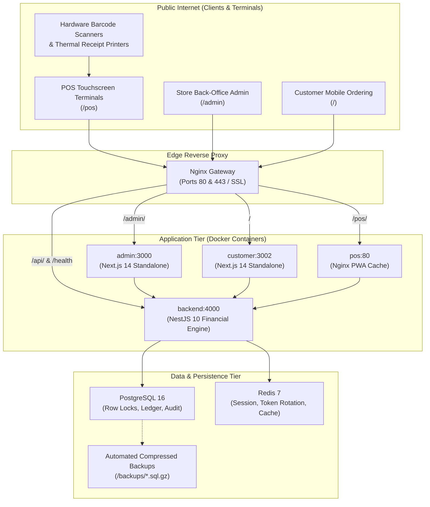

# Somnob POS Ecosystem — Production Deployment & Operations Guide

This guide details the production architecture, multi-container deployment, SSL/TLS reverse proxying, automated disaster recovery, and operational maintenance for the Somnob Point of Sale ecosystem.

---

## 1. Production Architecture Topology



---

## 2. Infrastructure & Sizing Requirements

| Component | Minimum Specification | Recommended Production Specification |
| :--- | :--- | :--- |
| **CPU** | 2 vCPUs | 4 to 8 vCPUs |
| **RAM** | 4 GB | 8 GB to 16 GB |
| **Disk Storage** | 40 GB SSD (NVMe preferred) | 100+ GB NVMe SSD with automated snapshots |
| **OS** | Ubuntu 22.04 LTS / Debian 12 | Ubuntu 24.04 LTS Server |
| **Docker Engine** | Version 24.0+ | Latest Docker CE with Compose v2 |

---

## 3. Production Environment Configuration

Create a secure `.env` file in the project root:

```bash
# ==============================================================================
# Somnob POS Production Environment
# ==============================================================================
NODE_ENV=production

# Database Credentials (Generate strong random passwords)
POSTGRES_USER=somnob_admin
POSTGRES_PASSWORD=generate_strong_64_char_password_here
POSTGRES_DB=somnob_pos_prod

# Port Configuration
HTTP_PORT=80
HTTPS_PORT=443

# Cryptographic Keys (Generate with: openssl rand -base64 48)
JWT_SECRET=generate_super_secret_jwt_key_minimum_48_chars
JWT_REFRESH_SECRET=generate_super_secret_jwt_refresh_key_minimum_48_chars
JWT_EXPIRES_IN=15m
JWT_REFRESH_EXPIRES_IN=7d

# Public Gateway URLs
NEXT_PUBLIC_API_URL=https://pos.yourdomain.com/api
```

> [!CAUTION]
> Never commit production `.env` files or hardcode passwords in version control. Always generate strong random keys using `openssl rand -base64 48`.

---

## 4. Multi-Stage Container Builds & Launch

The ecosystem provides multi-stage, hardened Dockerfiles for every service:
* `apps/backend/Dockerfile`: Alpine Linux with OpenSSL, non-root user (`USER node`), Prisma client generation.
* `apps/pos/Dockerfile`: Static compilation served via Nginx Alpine with gzip compression and immutable asset caching.
* `apps/admin/Dockerfile`: Next.js 14 standalone output image (`node server.js`) running as non-root.
* `apps/customer/Dockerfile`: Next.js 14 standalone mobile ordering app running as non-root.

### Launch Commands:

```bash
# 1. Build and launch all production containers in detached mode
docker compose -f docker-compose.prod.yml up -d --build

# 2. Run Prisma database migrations to apply latest schema
docker compose -f docker-compose.prod.yml exec backend npm run db:deploy

# 3. (First-time only) Seed initial business and super administrator account
docker compose -f docker-compose.prod.yml exec backend npm run db:seed

# 4. Verify running services and health status
docker compose -f docker-compose.prod.yml ps
```

---

## 5. Health Probes & Monitoring

The backend exposes liveness and readiness probe endpoints for orchestrators (Kubernetes / Docker Swarm / AWS ECS):

* **System Health:** `GET http://localhost/health`
  ```json
  {
    "status": "ok",
    "service": "somnob-pos-backend",
    "timestamp": "2026-10-18T09:15:00.000Z",
    "database": "healthy",
    "uptime": 12480.5
  }
  ```
* **Liveness Probe:** `GET http://localhost/health/live` (Returns HTTP 200 if process is responsive)
* **Readiness Probe:** `GET http://localhost/health/ready` (Returns HTTP 200 only when PostgreSQL is connected)

---

## 6. Automated Backup Strategy & Disaster Recovery

### Manual Backup:
```bash
./scripts/backup-db.sh
```
This script dumps the PostgreSQL database into `./backups/somnob_pos_prod_YYYYMMDD_HHMMSS.sql.gz` using gzip compression and automatically retains the last 7 daily archives.

### Automated Daily Cron Schedule:
Add the following line to `crontab -e`:
```cron
0 2 * * * /path/to/somnob-pos/scripts/backup-db.sh >> /var/log/somnob-db-backup.log 2>&1
```

### Database Restoration Drill:
To restore from a backup:
```bash
./scripts/restore-db.sh ./backups/somnob_pos_prod_20261018_020000.sql.gz
```

---

## 7. Zero-Downtime Rolling Update Workflow

When deploying new features or bug fixes to production:

```bash
# 1. Pull latest verified release
git pull origin main

# 2. Build updated images
docker compose -f docker-compose.prod.yml build

# 3. Apply non-breaking database schema migrations
docker compose -f docker-compose.prod.yml exec backend npm run db:deploy

# 4. Recreate updated application containers sequentially
docker compose -f docker-compose.prod.yml up -d --no-deps backend
docker compose -f docker-compose.prod.yml up -d --no-deps admin
docker compose -f docker-compose.prod.yml up -d --no-deps pos
docker compose -f docker-compose.prod.yml up -d --no-deps customer

# 5. Reload Gateway proxy
docker compose -f docker-compose.prod.yml exec gateway nginx -s reload
```

Active POS cashier shifts remain uninterrupted because offline-first IndexedDB caching in `apps/pos` buffers sales locally if network connectivity drops momentarily during container restarts.
